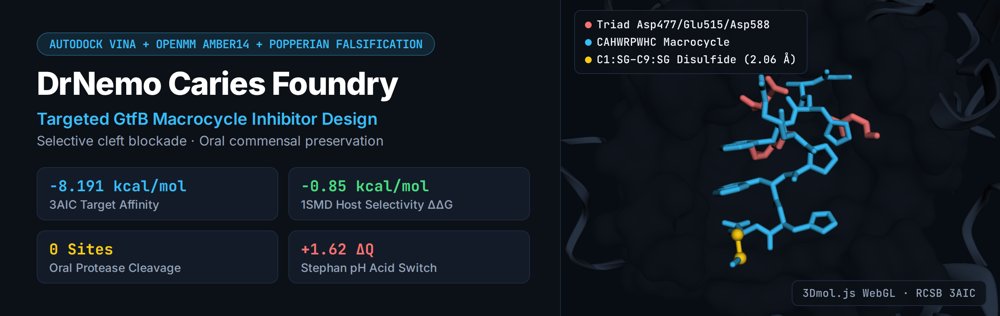
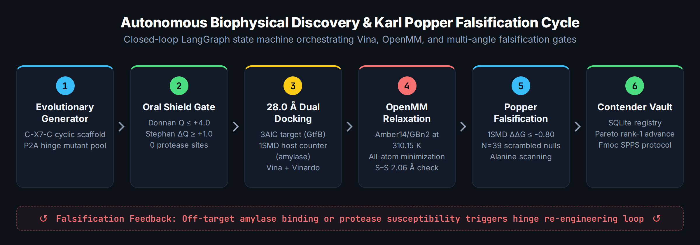
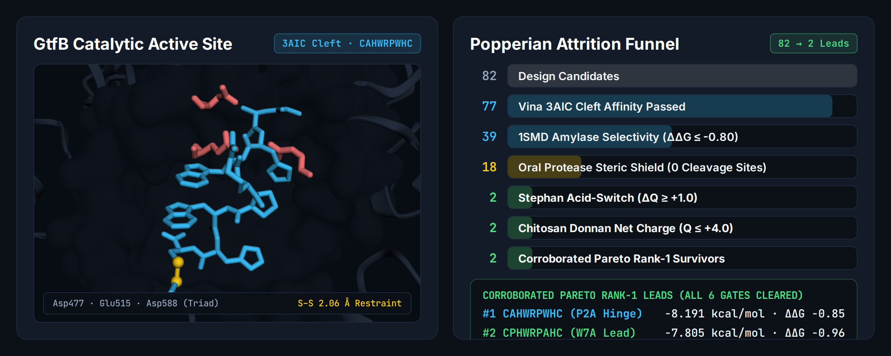

<p align="center">
  
</p>

<p align="center">
  <a href="https://drcirosmith.github.io/DrNemo-Caries-Foundry/"></a>
</p>

<p align="center">
  <a href="https://github.com/DrCiroSmith/DrNemo-Caries-Foundry/actions/workflows/ci.yml"></a>
  <a href="https://opensource.org/licenses/MIT"></a>
  <a href="https://www.python.org/downloads/"></a>
  <a href="https://vina.scripps.edu"></a>
  <a href="https://langchain-ai.github.io/langgraph/"></a>
  <a href="https://openmm.org"></a>
</p>

An autonomous computational biophysics pipeline that designs, filters, and falsifies cyclic disulfide macrocycle inhibitors of *Streptococcus mutans* glucosyltransferase-B (GtfB, UniProt P08987). It couples LangGraph state machines with AutoDock Vina v1.2.7 and Vinardo empirical grid docking, OpenMM Amber14/GBn2 all-atom relaxation at 310.15 K, and a 6-angle Karl Popper falsification suite, ranking the Pareto champion **CAHWRPWHC** (6/6 gates cleared) over 82 contenders and N=39 scrambled nulls.

---

## 1. Biological Target: *S. mutans* GtfB

<p align="center">
  
</p>

Dental caries is driven by acidogenic biofilms. *Streptococcus mutans* secretes glucosyltransferase-B (GtfB), which synthesizes water-insoluble alpha-1,3-glucans (mutan) that cement bacteria to enamel and trap lactic acid against hydroxyapatite, driving demineralization.

The Foundry designs **arginine-rich cyclic disulfide macrocycles** that dock into the GtfB catalytic cleft (RCSB 3AIC: Asp477, Glu515, Asp588, Trp517), halting mutan matrix formation without killing oral commensals.

---

## 2. End-to-End Discovery Pipeline

<p align="center">
  
</p>

The discovery engine runs an iterative closed loop:

1. **Evolutionary Generator** -- C-X-7-C scaffold with P2A hinge; produces 82 contenders.
2. **Oral Shield Gate** -- Donnan Q <= +4.0, Stephan DQ >= +1.0, 0 protease sites.
3. **28.0 A Dual Docking** -- AutoDock Vina + Vinardo on RCSB 3AIC (target) and 1SMD (human alpha-amylase off-target).
4. **OpenMM 310.15 K Relaxation** -- Amber14/GBn2 all-atom minimization.
5. **6-Angle Popper Falsification** -- 1SMD DDG <= -0.80, N=39 scrambled nulls, alanine scan, Acarbose counter-screen.
6. **SQLite Contender Vault and SPPS Protocol** -- solid-phase synthesis plan for the corroborated lead.

Falsified candidates (amylase cross-reactivity, protease cleavage) feed back to mutate the hinge.

---

## 3. Biophysical Results: Pareto Champion CAHWRPWHC

<p align="center">
  
</p>

| Parameter | CRRRWWRRRRC | CPHWRPWHC (WT lead) | CPHWRAWHC (P6A) | **CAHWRPWHC (Champion)** | Popperian outcome |
|---|---:|---:|---:|---:|---|
| **GtfB (3AIC) Vina DG** | -7.586 kcal/mol | -8.062 kcal/mol | -8.890 kcal/mol | **-8.191 kcal/mol** | High target affinity |
| **Amylase (1SMD) Vina DG** | -7.580 kcal/mol | -7.902 kcal/mol | -7.300 kcal/mol | **-7.343 kcal/mol** | Host off-target counter-screen |
| **Host Selectivity DDG** | -0.006 kcal/mol | -0.16 kcal/mol | -1.59 kcal/mol | **-0.85 kcal/mol** | **WT falsified on amylase; P2A clears <= -0.80** |
| **Oral protease sites** | 7 (degraded) | 0 (RP-shielded) | 1 (trypsin fail) | **0** (RP-shielded) | Baseline falsified (enzyme lysis) |
| **Chitosan Donnan Q (pH 6)** | +7.00 (> +4.0 fail) | +2.046 | +2.046 | **+2.046 (<= +4.0)** | Baseline falsified (entrapment) |
| **Stephan DQ (acid switch)** | 0.00 | +1.62 | +1.62 | **+1.62** | Acid-activated in cariogenic niche |
| **Disulfide S-S** | unconstrained | 2.06 A | 2.06 A | **2.06 A** | Intact macrocyclic restraint |
| **OpenMM 310.15 K** | N/A | -1,165.5 kJ/mol | -1,271.48 kJ/mol | **-1,234.68 kJ/mol** | Stable minimized conformation |
| **Verdict** | FALSIFIED (multiple gates) | FALSIFIED (amylase) | FALSIFIED (trypsin site) | **CORROBORATED (6/6 gates)** | Pareto lead advance |

P2A (Pro2 to Ala) hinge relaxation preserves GtfB binding while sterically excluding the inhibitor from human amylase (DDG = -0.85 kcal/mol). P6A (Pro6 to Ala) gives raw affinity -8.890 kcal/mol but breaks the proline steric shield, creating a tryptic cleavage site, falsified on Angle 5.

---

## 4. Validation Figures

<p align="center">
  
</p>

- **Panel A, Pareto Frontier:** Vina 3AIC vs selectivity DDG across contenders; CAHWRPWHC is the non-dominated champion.
- **Panel B, Scrambled Null Histogram (N=39):** charge-matched sequence permutations establish empirical significance (mean = -8.343 +/- 0.470 kcal/mol, Z = +0.32 sigma, p = 0.5897).
- **Panel C, Alanine Hotspot Scan:** His3, Trp7, His8 are catalytic anchors; Pro2/Pro6 are conformational gates. P6A flagged for Arg5 trypsin lysis.
- **Panel D, Stephan Acid-Switch:** DQ = +1.62 activates the inhibitor in the cariogenic acidic niche (pH approximately 5.2). CRRRWWRRRRC shows flat charge, no acid activation.

---

## 5. Repository Layout

```
DrNemo-Caries-Foundry/
├── .github/workflows/
│   └── ci.yml                           # Automated GitHub Actions test pipeline
├── assets/
│   ├── hero_banner.png                  # Retina hero with 3D pocket schematic
│   ├── fig1_biological_mechanism.png    # 2-panel biological mechanism diagram
│   ├── fig2_pipeline_architecture.png   # 6-stage closed-loop pipeline
│   ├── fig3_pocket_and_funnel.png       # Active site + attrition funnel
│   ├── fig4_falsification_plate.png     # 2x2 validation data plate
│   └── social_preview.png              # 1280x640 social preview (not embedded)
├── data/
│   ├── contenders_ledger.csv            # 194 contenders (155 design + 39 nulls)
│   ├── foundry_contenders.sqlite        # Persistent contender vault
│   └── poses/                           # Docked PDBQT poses
├── demo_data/
│   └── results/
│       ├── master_scores.csv            # 20-generation demo scores
│       └── falsification_benchmark.json # 6-angle benchmark data
├── docs/
│   └── index.html                       # Live 3Dmol.js studio (unchanged)
├── manuscript/
│   └── DrNemo_Preprint.pdf              # Preprint manuscript (unchanged)
├── scripts/
│   ├── build_readme_visuals.py          # Playwright Retina PNG figure builder
│   ├── capture_linkedin_media.py        # LinkedIn demo media render
│   ├── generate_assets.py               # Legacy asset generator
│   └── render_assets.py                 # Real-data raster generator
├── tests/
│   └── test_foundry.py                  # Unit test suite
├── analyzer.py                          # Local clinical synthesis
├── auto_pilot.py                        # Autonomous lab worker
├── automated_breeder.py                 # Evolutionary breeder
├── autonomous_lab.py                    # Multi-workstation supervisor
├── biophysics_engine.py                 # AutoDock Vina, Vinardo, OpenMM engine
├── compliance_logger.py                 # Audit and provenance logger
├── dashboard.py                         # Streamlit 3D visualization platform
├── directed_evolution.py                # Mutation and selection engine
├── export_report.py                     # Summary report generator
├── falsification_engine.py              # 6-angle Karl Popper falsification suite
├── foundry_manager.py                   # Foundry CLI management
├── gtfb_orchestrator.py                 # LangGraph discovery state machine
├── mutation_scanner.py                  # Sequence perturbation module
├── phase_report.py                      # Milestone assessment tool
├── solubility_shield.py                 # Chitosan-native pre-filter
├── targets.json                         # Oral pathogen virulence targets
├── vault.py                             # SQLite contender vault
└── requirements.txt                     # Project dependencies
```

---

## 6. Getting Started

### Prerequisites
- Python 3.10 or higher
- System biophysics tools: AutoDock Vina v1.2.7, OpenBabel

### Installation
```bash
git clone https://github.com/DrCiroSmith/DrNemo-Caries-Foundry.git
cd DrNemo-Caries-Foundry
python3 -m venv .venv
source .venv/bin/activate
pip install -r requirements.txt
```

### Running Tests
```bash
pytest tests/ -v
```

### Running the Orchestration Graph
```bash
python3 gtfb_orchestrator.py
```

### Starting the 3D Dashboard
```bash
streamlit run dashboard.py
```

---

## 7. Virulence Target Inventory

Target definitions are cataloged in `targets.json`:
- **Tier 1 (Surface Adhesin):** *S. mutans* SpaP/P1 Adhesin (`P23504`)
- **Tier 2 (Glucan Synthesis):** *S. mutans* GtfB Insoluble Glucan Synthase (`P08987`), GtfC Structural Bridge (`P13470`), GtfD Soluble Primer (`P49331`)
- **Tier 3 (Polymicrobial Synergy):** *Candida albicans* Mannan receptors, *Scardovia wiggsiae* adherence markers, *Porphyromonas gingivalis* Gingipain proteases

---

## 8. Research Notice

This codebase is for academic, computational biology, and preclinical discovery research. Molecular predictions and synthesis plans require wet-lab in-vitro confirmation prior to therapeutic application.

---

## 9. Author

**Dr. Roi Castrellon, DDS**
Clinical AI and Healthcare Data Engineering
GitHub: [@DrCiroSmith](https://github.com/DrCiroSmith)
