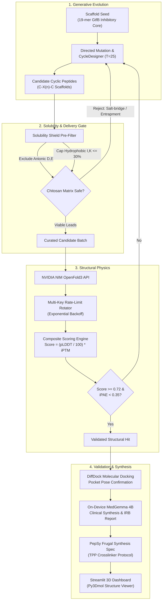

# Dr. Nemo Caries Vaccine Foundry

[](https://github.com/DrCiroSmith/DrNemo-Caries-Foundry/actions/workflows/ci.yml)
[](https://opensource.org/licenses/MIT)
[](https://www.python.org/downloads/)
[](https://build.nvidia.com)
[](https://langchain-ai.github.io/langgraph/)

An autonomous, multi-agent computational biology platform engineered to design, filter, validate, and clinically characterize cyclic peptide inhibitors targeting cariogenic oral biofilms.

---

## 1. Clinical & Molecular Rationale

Dental caries remains the most prevalent chronic non-communicable disease worldwide, driven primarily by acidogenic oral biofilms dominated by ***Streptococcus mutans***. Virulence relies heavily on two mechanisms:
1. **Initial Adhesion:** Mediated by surface adhesin **SpaP/P1** (UniProt `P23504`) binding salivary pellicle receptors.
2. **Extracellular Polysaccharide (EPS) Matrix Synthesis:** Mediated by glucosyltransferases—principally **GtfB** (UniProt `P08987`), which produces water-insoluble $\alpha$-(1,3)-rich glucans (mutan) that cement bacteria to tooth enamel and sequester organic acids against the hydroxyapatite crystal lattice.

```
Salivary Pellicle + Tooth Enamel
           │
     [ SpaP Adhesin ] ──> Primary Attachment
           │
     [ GtfB / GtfC ]  ──> Synthesizes Insoluble Mutan Matrix (Biofilm Core)
           │
  Acid Accumulation   ──> Hydroxyapatite Demineralization (Caries Lesion)
```

Traditional broad-spectrum antiseptics (e.g., chlorhexidine) disrupt the protective commensal oral microbiome, leading to opportunistic recolonization. The **Dr. Nemo Foundry** designs targeted **cyclic peptide molecular wedges** that selectively insert into the electronegative catalytic cleft of GtfB/C enzymes, blocking EPS synthesis without indiscriminate antimicrobial toxicity.

---

## 2. End-to-End System Architecture

The foundry couples **in-silico structural generation**, **physicochemical matrix constraints**, **cloud-accelerated structural prediction**, **molecular docking**, and **on-device clinical synthesis**:



---

## 3. Core Subsystems

### A. LangGraph Multi-Agent Orchestration (`gtfb_orchestrator.py`)
State machine coordinating the discovery loop across distinct execution nodes:
- **`cycle_designer_node`:** Generates arginine-enriched cyclic peptides with disulfide bridges (`C...C`) calibrated to $T=25$ diffusion steps.
- **`evaluate_openfold_node`:** Dispatches structural predictions against the GtfB catalytic pocket.
- **`filter_composite_node`:** Evaluates structural metrics against clinical thresholds.
- **`biosecurity_check_node`:** Screens candidate sequences against International Gene Synthesis Consortium (IGSC) biosecurity standards.
- **`synthesis_formatter_node`:** Produces automated solid-phase peptide synthesis (SPPS) pump-timing instructions.

### B. Solubility Shield & Delivery Compatibility (`solubility_shield.py`)
Candidate peptides intended for topical oral administration must function within a mucoadhesive **Chitosan/PVA film**:
- **Anionic Exclusion ($D + E \le 2$):** Eliminates polyelectrolyte complexation and insoluble salt-bridge precipitation with polycationic chitosan chains.
- **Entrapment Density Cap ($I + K \le 30\%$):** Prevents irreversible physical entrapment caused by excessive ring hydrogen bonding.
- **Arginine ($R$) Preference:** Maintains high positive charge density ($\text{pI} > 10$) to electrostatically target the negatively charged aspartate/glutamate catalytic triad of GtfB while preserving repellent mobility within the chitosan delivery vehicle.
- **Oral Saliva Stability ($\text{pH } 6.8$):** Enforces GRAVY hydropathy index $\le 2.0$ and instability index $\le 40.0$.

### C. NVIDIA NIM OpenFold3 Structural Validation (`pipeline.py`)
Predicts complex 3D structures and inter-chain binding interfaces using NVIDIA Health Cloud microservices:
$$\text{Composite Score} = \left(\frac{\text{pLDDT}}{100}\right) \times \text{iPTM}$$
- **Graduation Gate:** Composite Score $\ge 0.72$, with inter-residue interface Predicted Aligned Error $\text{iPAE} < 0.35$.
- **High-Throughput Key Rotator:** Asynchronous worker threads balance requests across available API keys, managing rate limits with dynamic jittered exponential backoff.

### D. Molecular Docking via DiffDock (`diffdock_pipeline.py`)
Performs physics-based blind docking of generated peptide fragments and small-molecule controls against cariogenic target crystals to confirm binding pocket occupancy and contact residues.

### E. Clinical Translation via On-Device MedGemma (`analyzer.py`)
Runs quantized **MedGemma 4B** locally via Ollama to evaluate raw physical coordinates:
- Analyzes predicted atomic contacts, steric compatibility, and charge distribution.
- Generates structured, literature-grade clinical justification memos suitable for regulatory and IRB documentation.

### F. Interactive 3D Structural Dashboard (`dashboard.py`)
Streamlit-based user interface featuring:
- Real-time telemetry across generation batches and score distributions.
- Embedded **Py3Dmol** WebGL canvas for interactive 3D rotation, cartoon coloring, and pocket contact inspection.
- Filterable leaderboard of graduated leads with download capability.

---

## 4. Repository Structure

```
DrNemo-Caries-Foundry/
├── .github/workflows/
│   └── ci.yml               # Automated GitHub Actions test pipeline
├── tests/
│   └── test_foundry.py      # Unit tests for filtering, catalog, and graph
├── analyzer.py              # MedGemma local clinical synthesis engine
├── auto_pilot.py            # Headless autonomous research daemon
├── automated_breeder.py     # Evolution gradient breeder
├── autonomous_lab.py        # Central multi-workstation lab coordinator
├── compliance_logger.py     # Audit trails and run provenance logging
├── dashboard.py             # Streamlit 3D visualization platform
├── diffdock_pipeline.py     # DiffDock molecular docking harness
├── directed_evolution.py    # Top-scoring candidate mutation engine
├── export_report.py         # Summary report generation utility
├── gtfb_orchestrator.py     # LangGraph stateful discovery workflow
├── mutation_scanner.py      # Amino acid perturbation and scanning
├── phase_report.py          # Phase-gate milestone evaluation
├── pipeline.py              # NVIDIA NIM OpenFold3 async prediction pipeline
├── solubility_shield.py     # Chitosan-native physicochemical pre-filter
├── targets.json             # Oral pathogen virulence target catalog
└── requirements.txt         # Project dependencies
```

---

## 5. Quickstart

### Prerequisites
- Python 3.10+
- Optional: Local [Ollama](https://ollama.ai) daemon with `gemma` or `llama3` for offline clinical synthesis
- Optional: NVIDIA Developer API key for cloud OpenFold3 predictions

### Installation
```bash
# Clone repository
git clone https://github.com/DrCiroSmith/DrNemo-Caries-Foundry.git
cd DrNemo-Caries-Foundry

# Create virtual environment
python3 -m venv .venv
source .venv/bin/activate

# Install dependencies
pip install -r requirements.txt
```

### Running the Tests
```bash
pytest tests/ -v
```

### Running the Autonomous Discovery Graph
```bash
python3 gtfb_orchestrator.py
```

### Launching the 3D Dashboard
```bash
streamlit run dashboard.py
```

---

## 6. Target Virulence Catalog

The foundry maintains verified target profiles in `targets.json`:
- **Tier 1 (Adhesion):** *S. mutans* SpaP/P1 Adhesin (`P23504`)
- **Tier 2 (Matrix Synthesis):** *S. mutans* GtfB Insoluble Glucan Synthase (`P08987`), GtfC Structural Bridge (`P13470`), GtfD Primer (`P49331`)
- **Tier 3 (Polymicrobial Synergy):** *Candida albicans* O/N-Mannan receptors, *Scardovia wiggsiae* aciduric adherence proteins, *Porphyromonas gingivalis* Gingipain proteases

---

## 7. Disclaimer

*This software is intended exclusively for academic, computational biology, and preclinical discovery research. In-silico predictions and synthetic protocols require physical in-vitro validation before therapeutic use.*

---

## 8. Author

**Dr. Roi Castrellon, DDS**  
Clinical AI & Healthcare Data Engineering  
GitHub: [@DrCiroSmith](https://github.com/DrCiroSmith)
