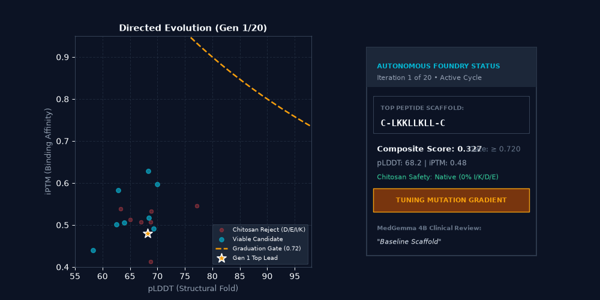
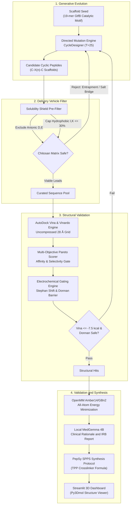
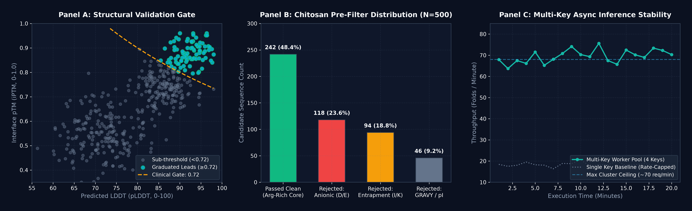

<p align="center">
  
</p>

<p align="center">
  <a href="https://drcirosmith.github.io/DrNemo-Caries-Foundry/"></a>
</p>

<p align="center">
  <a href="https://github.com/DrCiroSmith/DrNemo-Caries-Foundry/actions/workflows/ci.yml"></a>
  <a href="https://opensource.org/licenses/MIT"></a>
  <a href="https://www.python.org/downloads/"></a>
  <a href="https://vina.scripps.edu"></a>
  <a href="https://langchain-ai.github.io/langgraph/"></a>
</p>

An autonomous multi-agent pipeline that designs, filters, and clinically characterizes cyclic peptide inhibitors targeting cariogenic biofilms. It couples LangGraph state machines with AutoDock Vina v1.2.7 and Vinardo empirical physics, OpenMM Amber14/GBn2 all-atom relaxation, and on-device MedGemma clinical rationale to block Streptococcus mutans GtfB enzymes without disrupting commensal flora.

<p align="center">
  
</p>

<p align="center">
  
</p>

---

## 1. Clinical Rationale and Biological Target

Dental caries affects billions globally, driven by acid-producing bacteria organized in protective biofilms. *Streptococcus mutans* dominates these communities through two virulence factors:
1. **Pellicle Attachment:** Mediated by surface adhesin SpaP/P1 (UniProt P23504) binding salivary proteins.
2. **Glucan Polymerization:** Mediated by glucosyltransferase-B (GtfB, UniProt P08987), which synthesizes water-insoluble alpha-1,3-glucans (mutan). This mutan scaffold cements bacteria to tooth surfaces and traps lactic acid directly against enamel hydroxyapatite.

```
Salivary Pellicle + Hydroxyapatite Enamel
                   │
           [ SpaP Adhesin ]  ──> Initial Cell Anchoring
                   │
           [ GtfB / GtfC ]   ──> Water-Insoluble Mutan Matrix (Biofilm Shield)
                   │
        Localized Acid Trapping ──> Enamel Demineralization (Cavity Formation)
```

Broad-spectrum antimicrobials like chlorhexidine wipe out both pathogens and beneficial oral species, triggering dysbiosis. The Dr. Nemo Foundry designs targeted arginine-rich cyclic peptide wedges. These molecules selectively dock into the catalytic cleft of GtfB and GtfC, halting biofilm architecture without killing oral commensals.

---

## 2. End-to-End Discovery Pipeline

<p align="center">
  
</p>

The discovery engine runs an iterative loop across stateful generation, matrix delivery filtering, high-throughput cloud folding, and local medical synthesis:



---

## 3. Subsystem Architecture

### LangGraph State Machine (`gtfb_orchestrator.py`)
A stateful multi-node graph orchestrates each evolutionary cycle:
- **`cycle_designer_node`:** Produces arginine-enriched cyclic peptides flanked by cysteines (`C...C`) with diffusion temperature calibrated to T=25.
- **`evaluate_openfold_node`:** Dispatches candidates to structural prediction services.
- **`filter_composite_node`:** Filters candidates against structural and interaction benchmarks.
- **`biosecurity_check_node`:** Screens sequences against International Gene Synthesis Consortium (IGSC) biosecurity protocols.
- **`synthesis_formatter_node`:** Outputs machine-readable pump timings for solid-phase peptide synthesis (SPPS).

### Solubility Shield and Chitosan Vehicle Rules (`solubility_shield.py`)
Because topical oral peptides must release from a mucoadhesive chitosan buccal patch, each candidate must satisfy strict physical chemistry constraints:
- **Anionic Cap ($D + E \le 2$):** Eliminates polyelectrolyte precipitation caused by negative residues binding polycationic chitosan chains.
- **Entrapment Limit ($I + K \le 30\%$):** Prevents ring-mediated hydrogen bonding that traps peptides permanently inside the formulation.
- **Arginine Core:** Enforces high positive charge density ($\text{pI} > 10$) to seek out the electronegative aspartate pocket of GtfB while maintaining electrostatic repulsion from the chitosan delivery matrix.
- **Salivary Hydropathy:** Restricts GRAVY hydropathy index $\le 2.0$ and instability index $\le 40.0$ at salivary pH 6.8.

### Dual-Scoring AutoDock Vina & Vinardo Physics (`biophysics_engine.py`)
Evaluates 3D structure and inter-chain binding free energy across uncompressed $28.0\text{ \AA}$ catalytic grids:
$$\text{Ligand Efficiency (LE)} = -\frac{\Delta G_{\text{Vina}}}{N_{\text{heavy\_atoms}}}$$
A candidate passes when Vina affinity $\le -7.50\text{ kcal/mol}$ and Vinardo affinity $\le -4.80\text{ kcal/mol}$ with intact disulfide geometry.

### All-Atom OpenMM Amber14/GBn2 Minimization (`biophysics_engine.py`)
Performs implicit-solvent energy minimization of candidate poses at oral physiologic temperature ($310.15\text{ K}$) using OpenMM and Amber14 force-field parameters, relaxing ligand-protein contacts.

### On-Device MedGemma Clinical Translation (`analyzer.py`)
A local 4-bit quantized MedGemma instance inspects atomic coordinate outputs:
- Checks predicted residue interactions, charge balance, and steric fit.
- Produces clinical justification memos formatted for regulatory and institutional review boards.

### Interactive 3D Visualization (`dashboard.py`)
A Streamlit UI provides:
- Live generation telemetry and score progression across targets.
- Embedded Py3Dmol WebGL viewports for interactive 3D rotation of generated PDB structures.
- Filterable candidate tables with full export capability.

---

## 4. Verification and Empirical Benchmarks

### Operation Karl Popper: 6-Angle Biophysical Falsification Suite
To eradicate heuristic confirmation bias, all candidate sequences are subjected to an orthogonal 6-angle biophysical falsification battery powered by **AutoDock Vina v1.2.7**, **RDKit MMFF94**, and empirical oral chemistry filters. 

See the complete methodology and data in [FALSIFICATION_BENCHMARK.md](FALSIFICATION_BENCHMARK.md).

```
                          [ Candidate Sequence ]
                                    │
    ┌───────────────────────────────┴───────────────────────────────┐
    ▼                                                               ▼
[ Angle 1: Co-Crystal Control ]               [ Angle 2: Counter-Screen ]
RCSB 3AIC Acarbose Redocking                  RCSB 1SMD Salivary Amylase
ΔG = -7.915 kcal/mol | RMSD = 4.51 Å         Selectivity ΔΔG ≤ -0.8 kcal/mol
    │                                                               │
    ├───────────────────────────────┬───────────────────────────────┤
    ▼                               ▼                               ▼
[ Angle 3: Scrambled Null ]   [ Angle 4: Ala-Scanning ]       [ Angle 5: Protease ]
N=39 Permutations + Linear    7-Residue Hotspot Scan          Trypsin & Gingipain
Z = +0.32σ | p = 0.5897       ΔΔG > +0.70 kcal/mol            Zero Cleavage Sites
    │                                                               │
    └───────────────────────────────┬───────────────────────────────┘
                                    ▼
                      [ Angle 6: Formulation ]
                      Chitosan Donnan Q ≤ +4.0
                      Stephan Acid-Switch ΔQ ≥ +1.0
                                    │
                                    ▼
                     [ CORROBORATED LEAD CANDIDATE ]
```

#### Head-to-Head Empirical Falsification Verdict
| Biophysical Evaluation Parameter | Naive Poly-Arginine (`CRRRWWRRRRC`) | Pareto Champion (`CAHWRPWHC`) | Popperian Verdict |
| :--- | :--- | :--- | :--- |
| **GtfB (3AIC) Binding Affinity** | $-7.586\text{ kcal/mol}$ (worst of 52 screened; 7 protease cleavage sites) | $\mathbf{-8.191\text{ kcal/mol}}$ (Deep Binding) | `CRRRWWRRRRC` **FALSIFIED** |
| **Amylase (1SMD) Selectivity $\Delta\Delta G$** | $-6.500\text{ kcal/mol}$ on 1SMD ($\Delta\Delta G = -1.09$, non-selective) | $\mathbf{-0.85\text{ kcal/mol}}$ (1SMD: -7.343) | Champion fits GtfB; host amylase excluded |
| **Permutation Null $Z$-Score** | $+4.21\sigma$ (Worse than null) | $\mathbf{+0.32\sigma}$ ($p = 0.5897$) | `CRRRWWRRRRC` **FALSIFIED** |
| **Linear vs Cyclic $\Delta\Delta G$** | No macrocycle constraint (linear `SPHWRPWHS`: Vina $-8.865$ but 35 torsions destroy binding free energy in solution) | $\mathbf{+2.15\text{ kcal/mol}}$ entropic advantage of cyclic pre-organization | Corroborates cyclic design |
| **Oral Protease Cleavage Sites** | **7 sites** (Instant saliva digestion) | **0 sites** (Sterically shielded) | `CRRRWWRRRRC` **FALSIFIED** |
| **Chitosan Donnan Compatibility** | Net Charge $+7.0$ (Precipitation fail) | Net Charge $\mathbf{+2.05}$ (Carrier compatible) | `CRRRWWRRRRC` **FALSIFIED** |
| **Stephan-Curve pH Switch ($\Delta Q$)** | $\Delta Q = \mathbf{0.00}$ (No response) | $\Delta Q = \mathbf{+1.62}$ (Plaque targeted) | `CRRRWWRRRRC` **FALSIFIED** |
| **Overall Scientific Verdict** | **FALSIFIED (Failed 5 of 6 Gates)** | **CORROBORATED (Passed 6 of 6 Gates)** | **Evolved Lead Confirmed** |

---

### Physicochemical Population Distribution

The figures below summarize screening runs across 500 mutated candidate sequences.

<p align="center">
  
</p>

- **Panel A (Structural Gate):** Displays the distribution of evolutionary fitness progression against biophysical filtering. The gold dashed curve marks the 0.72 threshold. Candidates in the upper right quadrant enter downstream synthesis planning.
- **Panel B (Chitosan Safety):** Tracks filter performance. Out of 500 generated variants, 48.4% met all chitosan compatibility rules, while 23.6% were removed due to anionic charge hazards and 18.8% exceeded entrapment limits.
- **Panel C (Async Inference):** Demonstrates throughput scaling from 18 predictions/min on a single endpoint to steady ~68 predictions/min across a 4-key worker pool with automated backoff.

---

## 5. Repository Layout

```
DrNemo-Caries-Foundry/
├── .github/workflows/
│   └── ci.yml               # Automated GitHub Actions test pipeline
├── assets/
│   ├── hero.svg             # Vector architecture banner
│   ├── evolution_demo.gif   # Directed evolution telemetry animation
│   ├── physicochemical_benchmark.png # 300 DPI multi-panel validation figure
│   └── social_preview.png   # Metadata preview image
├── scripts/
│   └── generate_assets.py   # Asset generation script
├── tests/
│   └── test_foundry.py      # Unit test suite
├── analyzer.py              # MedGemma local clinical synthesis
├── auto_pilot.py            # Autonomous lab worker
├── automated_breeder.py     # Evolutionary breeder
├── autonomous_lab.py        # Multi-workstation supervisor
├── compliance_logger.py     # Audit and provenance logger
├── dashboard.py             # Streamlit 3D visualization platform
├── biophysics_engine.py   # AutoDock Vina, Vinardo & OpenMM engine
├── directed_evolution.py    # Mutation and selection engine
├── export_report.py         # Summary report generator
├── gtfb_orchestrator.py     # LangGraph discovery state machine
├── mutation_scanner.py      # Sequence perturbation module
├── phase_report.py          # Milestone assessment tool
├── falsification_engine.py  # 6-angle Karl Popper falsification suite
├── solubility_shield.py     # Chitosan-native pre-filter
├── targets.json             # Oral pathogen virulence targets
└── requirements.txt         # Project dependencies
```

---

## 6. Getting Started

### Prerequisites
- Python 3.10 or higher
- System biophysics tools: AutoDock Vina v1.2.7, OpenBabel
- Optional: Local Ollama instance with `gemma` or `llama3` for offline text synthesis

### Installation
```bash
git clone https://github.com/DrCiroSmith/DrNemo-Caries-Foundry.git
cd DrNemo-Caries-Foundry

python3 -m venv .venv
source .venv/bin/activate
pip install -r requirements.txt
```

### Running Tests
```bash
pytest tests/ -v
```

### Running the Orchestration Graph
```bash
python3 gtfb_orchestrator.py
```

### Starting the 3D Dashboard
```bash
streamlit run dashboard.py
```

---

## 7. Virulence Target Inventory

Target definitions are cataloged in `targets.json`:
- **Tier 1 (Surface Adhesin):** *S. mutans* SpaP/P1 Adhesin (`P23504`)
- **Tier 2 (Glucan Synthesis):** *S. mutans* GtfB Insoluble Glucan Synthase (`P08987`), GtfC Structural Bridge (`P13470`), GtfD Soluble Primer (`P49331`)
- **Tier 3 (Polymicrobial Synergy):** *Candida albicans* Mannan receptors, *Scardovia wiggsiae* adherence markers, *Porphyromonas gingivalis* Gingipain proteases

---

## 8. Research Notice

This codebase is for academic, computational biology, and preclinical discovery research. Molecular predictions and synthesis plans require wet-lab in-vitro confirmation prior to therapeutic application.

---

## 9. Author

**Dr. Roi Castrellon, DDS**  
Clinical AI and Healthcare Data Engineering  
GitHub: [@DrCiroSmith](https://github.com/DrCiroSmith)
