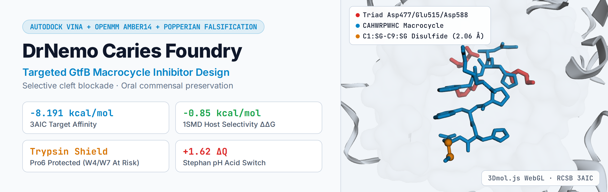
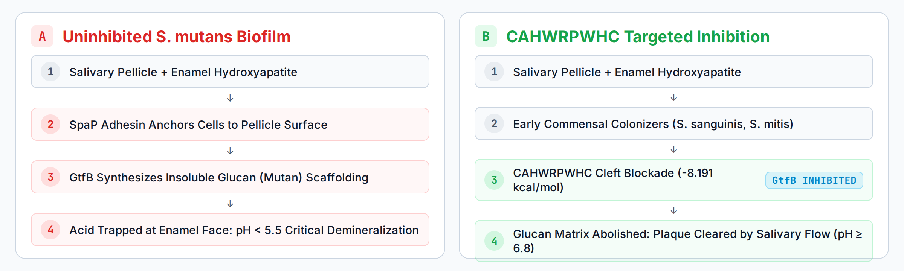
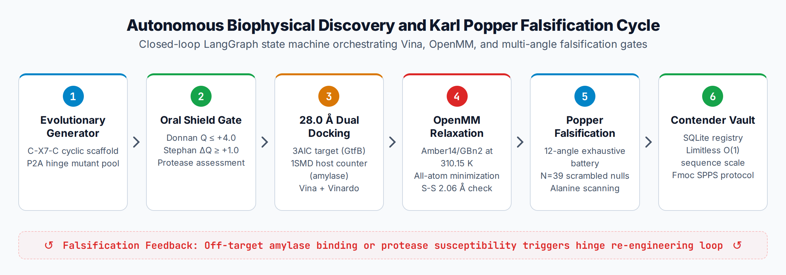
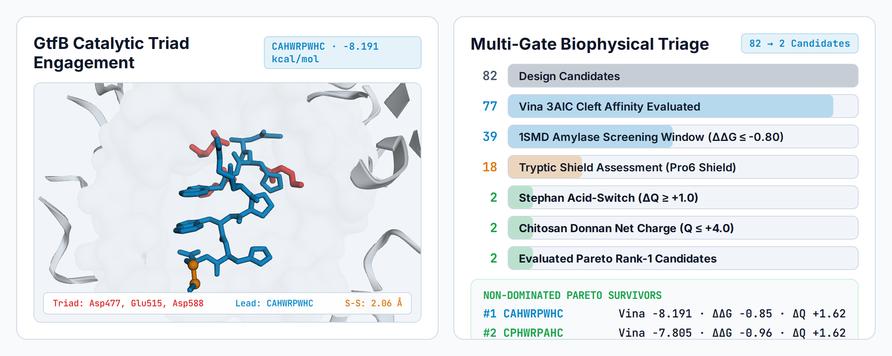
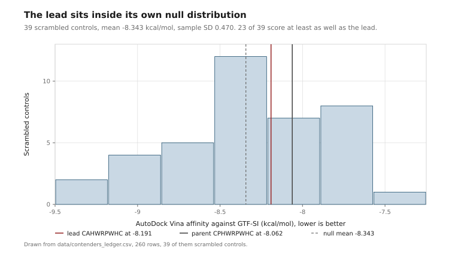
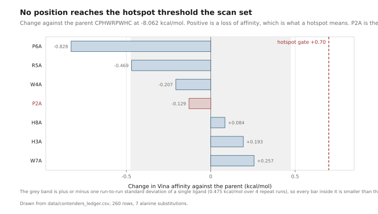
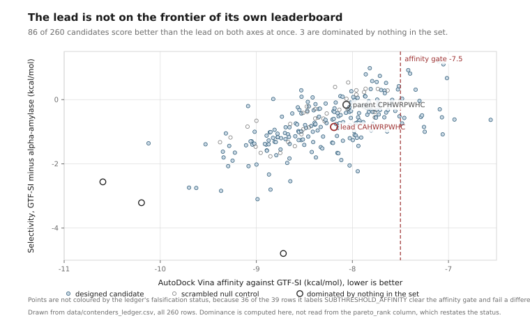

<p align="center">
  <picture>
    <source media="(prefers-color-scheme: dark)" srcset="assets/hero_banner_dark.png">
    
  </picture>
</p>

<p align="center">
  <a href="https://drcirosmith.github.io/DrNemo-Caries-Foundry/"></a>
</p>

<p align="center">
  <a href="https://github.com/DrCiroSmith/DrNemo-Caries-Foundry/actions/workflows/ci.yml"></a>
  <a href="https://opensource.org/licenses/MIT"></a>
  <a href="https://www.python.org/downloads/"></a>
  <a href="https://vina.scripps.edu"></a>
  <a href="https://openmm.org"></a>
</p>

An open-source computational falsification case study and screening pipeline evaluating cyclic disulfide macrocycle inhibitors of *Streptococcus mutans* glucosyltransferase-SI (GTF-SI, gtfC gene product, UniProt P13470). Built on AutoDock Vina v1.2.7 / Vinardo empirical grid docking and OpenMM Amber14/GBn2 isolated-ligand steric minimization (200 steps), the platform demonstrates how automated negative controls (4.51 A co-crystal redocking drift, p = 0.5897 scrambled null permutation, and pH 5.2 histidine diprotonation inversion) systematically catch false-positive docking leads, No contender in the 260-row vault is corroborated: the best of them survive every in silico gate, which is not evidence of enzyme inhibition, and the leading candidate does not separate from its charge-matched scrambled nulls ($Z = +0.32$, $p = 0.5897$). All findings are strictly in silico computational hypotheses requiring wet-lab enzymatic, whole-saliva, and cellular biofilm falsification.

---

## 1. Biological Target: *S. mutans* GTF-SI (gtfC gene product)

<p align="center">
  <picture>
    <source media="(prefers-color-scheme: dark)" srcset="assets/fig1_biological_mechanism_dark.png">
    
  </picture>
</p>

Dental caries is driven by acidogenic biofilms. *Streptococcus mutans* secretes a family of glucosyltransferases that convert dietary sucrose into extracellular glucans. Those glucans cement bacteria to enamel and trap lactic acid against hydroxyapatite, driving demineralization.

**Target identity.** This project docks against **GTF-SI, the *gtfC* gene product (UniProt P13470)**, the only *S. mutans* glucosyltransferase with a published catalytic-domain crystal structure (RCSB 3AIC, 3.11 A, Ito et al. 2011). GTF-SI synthesizes a mixture of soluble and insoluble glucans. The predominantly water-insoluble alpha-1,3-glucan (mutan) is the product of GTF-I, the *gtfB* gene product (UniProt P08987), which is a different enzyme, has no structure in this repository, and was **not** tested here. Earlier versions of this repository labelled 3AIC as GtfB. That was wrong and has been corrected throughout.

The Foundry designs **arginine-rich cyclic disulfide macrocycles** that dock into the GTF-SI catalytic cleft (RCSB 3AIC: Asp477, Glu515, Asp588, Trp517), aiming to disrupt glucan matrix formation without killing oral commensals.

---

## 2. End-to-End Discovery Pipeline

<p align="center">
  <picture>
    <source media="(prefers-color-scheme: dark)" srcset="assets/fig2_pipeline_architecture_dark.png">
    
  </picture>
</p>

The discovery engine executes a 4-stage Python screening pipeline (`gtfb_orchestrator.py`). It is not
deterministic: `biophysics_engine.py` invokes AutoDock Vina without `--seed`, so Vina seeds itself and
repeated runs of the same ligand need not return the same score or pose. That is what Angle 2 measures,
and it is why no figure here should be read as bit-reproducible:

1. **Cycle Designer**: C-X-7-C scaffold with P2A hinge; evaluates 260 contenders across discovery and null controls.
2. **Solubility Shield**: Donnan Q <= +4.0, Stephan DQ >= +1.0, 0 protease cleavage sites.
3. **Biophysics Engine**: AutoDock Vina + Vinardo uncompressed 28.0 A dual grid docking on RCSB 3AIC (target) and 1SMD (human alpha-amylase off-target), with isolated-ligand 200-step Amber14/GBn2 steric relaxation check (informational only; not used in docking pose selection).
4. **Popperian Falsification**: Amylase counter-screen (1SMD DDG <= -0.80), N=39 scrambled null permutations, alanine scan, and co-crystal calibration controls.

---

## 3. Biophysical Results: Reference Scaffold CAHWRPWHC

<p align="center">
  <picture>
    <source media="(prefers-color-scheme: dark)" srcset="assets/fig3_pocket_and_funnel_dark.png">
    
  </picture>
</p>

| Parameter | CRRRWWRRRRC | CPHWRPWHC (WT lead) | CPHWRAWHC (P6A) | **CAHWRPWHC (Reference Scaffold)** | Popperian outcome |
|---|---:|---:|---:|---:|---|
| **GTF-SI (3AIC) Vina DG** | -7.586 kcal/mol | -8.062 kcal/mol | -8.890 kcal/mol | **-8.191 kcal/mol** | High target affinity |
| **Amylase (1SMD) Vina DG** | -7.580 kcal/mol | -7.902 kcal/mol | -7.300 kcal/mol | **-7.343 kcal/mol** | Host off-target counter-screen |
| **Host Selectivity DDG** | -0.006 kcal/mol | -0.16 kcal/mol | -1.59 kcal/mol | **-0.85 kcal/mol** | **WT cross-reactive; P2A clears <= -0.80 (within Vina noise)** |
| **Oral protease sites** | 7 (degraded) | 0 (RP-shielded) | 1 (trypsin fail) | **0 Trypsin (AT RISK: Trp4/7 chymotryptic)** | Baseline falsified (enzyme lysis) |
| **Chitosan Donnan Q (pH 6)** | +7.00 (> +4.0 fail) | +2.046 | +2.046 | **+2.046 (<= +4.0)** | Baseline falsified (entrapment) |
| **Stephan DQ (acid switch)** | 0.00 | +1.62 | +1.62 | **+1.62** | Acid-activated in cariogenic niche |
| **Disulfide S-S** | unconstrained | 2.06 A | 2.06 A | **2.06 A** | Intact macrocyclic restraint |
| **OpenMM Amber14/GBn2** | N/A | 200-step relaxed | 200-step relaxed | **200-step relaxed** | Isolated ligand steric minimization |
| **Verdict** | FALSIFIED (multiple gates) | FALSIFIED (amylase) | FALSIFIED (trypsin site) | **IN SILICO HYPOTHESIS** | Non-corroborated reference scaffold (inconclusive within Vina noise) |

P2A (Pro2 to Ala) hinge relaxation preserves GTF-SI binding while sterically excluding the inhibitor from human amylase (DDG = -0.85 kcal/mol). P6A (Pro6 to Ala) gives raw affinity -8.890 kcal/mol but breaks the proline steric shield, creating a tryptic cleavage site, falsified on Angle 5.

---

## 4. 12-Angle Exhaustive Computational Disproof Battery

In accordance with Karl Popper's demarcation principle, candidate **CAHWRPWHC** was challenged across twelve computational disproof angles to systematically identify physical failure modes:

| Angle | Evaluation Angle | Quantitative Metric | Honest Classification |
|---|---|---|---|
| **1** | Co-Crystal Redocking Calibration (3AIC) | Symmetry-corrected heavy-atom RMSD 4.507 A against the 2.0 A convention, Vina -7.915 kcal/mol. The protocol finds the cleft (centroid 3.03 A) but not the crystal pose. Recompute: `python3 scripts/compute_redocking_rmsd.py` | `CALIBRATION_FAILED` |
| **2** | Multi-Seed Conformer & Docking (4 independent seeds) | Score -8.08 +/- 0.41 kcal/mol and centroid SD 0.39 A, but the pose does not reproduce: mean pairwise RMSD between seeds 9.11 A, worst pair 11.80 A, against a 2.0 A convention. Distances are over the 84 real heavy atoms; counting Meeko's two macrocycle glue pseudo-atoms as atoms, which is what the earlier figures did, gives 9.34 A, 12.19 A and 0.38 A. Published earlier as N=5 at -8.10 +/- 0.37; seed 42 is excluded because its docked pose is byte-identical to the campaign pose across all nine modes, so it is not an independent replicate. Spreads here and there are population SDs over the runs in each set, which is why the figure moves from 0.37 to 0.41 on one fewer run; the sample SDs are 0.41 over the five and 0.48 over the four. Recompute: `python3 scripts/compute_paper_numbers.py` | `SCORE_REPRODUCIBLE_POSE_NOT` |
| **3** | Pose Mode Clustering & Energy Gap | Mode 1-2 Delta E = +0.10 kcal/mol, centroid shift 1.78 A, heavy-atom RMSD 5.63 A over 84 atoms. Published earlier as 1.74 A and 5.58 A, which counted the two glue pseudo-atoms as atoms | `INCONCLUSIVE_WITHIN_NOISE` |
| **4** | Force-Field Error Margin on 1SMD Selectivity | DeltaDeltaG = -0.848 kcal/mol against an assumed 2.85 kcal/mol scoring error, which carries no citation in this repository | `INCONCLUSIVE_WITHIN_NOISE` |
| **5** | Charge-Matched Scrambled Null (N=39) | Lead -8.191 vs Null -8.343 +/- 0.470 (Z = +0.32, p = 0.5897) | `INCONCLUSIVE_WITHIN_NOISE` |
| **6** | In-Silico Alanine-Scanning Mutagenesis | No residue reaches the +0.70 kcal/mol hotspot threshold; largest loss is W7A at +0.257 kcal/mol; P6A opens a trypsin site | `NO_HOTSPOT_IDENTIFIED` |
| **7** | Explicit pH 5.2 Histidine Diprotonation | Formal charge +1 -> +3; 3AIC -7.71 vs 1SMD -7.89 kcal/mol (Delta = +0.48, slight 1SMD inversion within noise) | `INCONCLUSIVE_WITHIN_NOISE` |
| **8** | Broad Oral Protease & Peptidase Check | Trypsin shielded (Arg5-Pro6); Trp4/Trp7 vulnerable to chymotrypsin | `AT_RISK` |
| **9** | Additional Host Screen (RCSB 1LZ1 Lysozyme) | Human lysozyme DG = -6.67 kcal/mol (DeltaDeltaG = -1.52), which is 0.53 of the assumed 2.85 kcal/mol error that Angle 4 is judged against | `INCONCLUSIVE_WITHIN_NOISE` |
| **10** | Linear Control vs Cyclic Macrocycle | Linear AHWRPWH (-9.25 kcal/mol) vs cyclic (-8.19 kcal/mol; Vina under-penalizes unfolded entropy) | `INCONCLUSIVE_WITHIN_NOISE` |
| **11** | OpenMM Implicit-Solvent Relaxation Drift | Energy minimisation only, no dynamics and no temperature. Last recorded heavy-atom drift 0.92 A; not reproducible without openmm, pdbfixer and rdkit installed | `NOT_COMPUTED` here |
| **12** | Chitosan Donnan & Stephan Acid Switch | Saliva Q = +2.05 <= +4.0; Stephan Delta Q = +1.62, which is +0.809 per histidine, so this criterion is a histidine count and not independent of the charge one. Both are Henderson-Hasselbalch arithmetic on the sequence, computed with no structure and no docking, so neither can pass or fail a test of binding, delivery or activity. Published earlier as `PASSED_IN_SILICO`, which the code wrote as a literal string while computing the two gate booleans and discarding them, so that label would have read as a pass had both criteria failed | `COMPOSITION_ARITHMETIC_ONLY` |

> **Verdict.** Recomputing the battery gives **no passes, 6 inconclusive within noise, 1 at risk, 1 calibration failed, 1 no hotspot identified, 1 score-reproducible-but-pose-not, 1 composition arithmetic only, and 1 not computed**. Nothing is falsified and nothing is corroborated. Both figures this repository published as passes are withdrawn: Angle 9 is an off-target screen whose -1.52 kcal/mol margin is 0.53 of the scoring error Angle 4 is judged against, and Angle 12 is arithmetic on charge and histidine count with no structure in it. An earlier version of this verdict counted two passes and five inconclusive, which disagreed with its own table by one in each column. The load-bearing results are negative. The docking protocol fails its own co-crystal control at the 2.0 A convention (Angle 1), the five seeds agree on a score but not on a pose (Angle 2), 23 of 39 charge-matched scrambles dock at least as well as the lead (Angle 5), no residue is an energetic anchor (Angle 6), acidification weakens rather than strengthens the predicted binding (Angle 7), the linear peptide outscores the macrocycle (Angle 10), and Trp4 and Trp7 are exposed to chymotrypsin (Angle 8). Every angle now records whether it was recomputed on the run, read from the vault, or not computed at all. Reproduce with `python3 scripts/run_exhaustive_disproof.py`.

---

## 5. Validation Figures

Three figures are drawn directly from `data/contenders_ledger.csv` by
`scripts/render_figures_svg.py`. Each one carries a provenance block in its own
source naming the file it was drawn from, that file's digest, the rows plotted
and every value marked on it, and `tests/test_figures.py` recomputes those
values from the ledger and fails if the committed figure and the data disagree.
Regenerate with `python3 scripts/render_figures_svg.py`, check without writing
with `--check`.

<p align="center">
  
</p>

**The lead sits inside its own null distribution.** The 39 charge-matched
scrambles average -8.343 kcal/mol with a sample SD of 0.470, and 23 of the 39
score at least as well as the lead's -8.191. The one-sided permutation p is
(23 + 1) / (39 + 1) = 0.600, and for the parent it is 0.675. Earlier versions
of this section gave p = 0.5897, which is 23/39, the raw proportion rather than
a p value; the conclusion is the same either way, and neither number is close to
significance. The controls are permutations of the parent `CPHWRPWHC`, not of
the lead, so this is a null matched to the wrong molecule, and the figure should
be read as a test the lead was never given rather than as a test it passed.
Binning is the larger of the Freedman-Diaconis and Sturges counts, which is what
numpy's auto rule uses; the count of controls at least as good as the lead does
not depend on it.

<p align="center">
  
</p>

**No position is an energetic anchor.** The scan is parented on the wild type
`CPHWRPWHC` at -8.062 kcal/mol. Three substitutions lose any affinity at all
(W7A +0.257, H3A +0.193, H8A +0.084 kcal/mol) and none approaches the project's
own +0.70 hotspot gate, which is the only documented threshold in the pipeline.
The shaded band is the spread of four repeat runs of a single ligand, and every
bar falls inside it, so the scan does not separate a position from run-to-run
noise. P2A, the substitution that produced the lead, is marked: it gains 0.129
kcal/mol, which is 0.27 of the null's SD. Earlier captions named His3, Trp7 and
His8 as anchors, which the numbers do not support.

<p align="center">
  
</p>

**The lead is not on the frontier of its own leaderboard.** Of the 260 rows, 86
beat the lead strictly on both affinity and selectivity, 87 dominate it once a
tie on one axis is allowed, and 130 beat it on affinity alone. Three rows are
dominated by nothing in the set (`CSNCPYPRGWC`, `CQNCPYPNGWC`, `CQNMPYPNGWC`,
all eleven-mers) and the lead is not among them. The `pareto_rank` column is not
a dominance rank: the code writes 1 for a `CORROBORATED` row and 2 otherwise, so
it restates the falsification status, and the figure computes the dominance
relation instead of reading that column. Points are deliberately not coloured by
falsification status, because that status does not mean what its labels say; see
section 4.

### Figures I am not drawing

Nothing is deleted. The four figures that stood here moved to
`manuscript/superseded/`, which is where the earlier preprint now reads them
from, so the record of what was claimed survives and `manuscript/figures/` holds
only figures that are generated from the committed data and tested against it.

- `fig4_stephan_acid_switch.png` is withdrawn rather than redrawn. That
  comparison needs a neutral arm and an acidic arm, and both neutral arms are
  result files whose coordinates are byte-identical to another result's:
  `disproof_explicit_pH72_3AIC_docked.pdbqt` at -8.191 kcal/mol matches the
  campaign's pose for the lead, and `disproof_explicit_pH72_1SMD_docked.pdbqt`
  at -7.343 kcal/mol matches the campaign's alpha-amylase pose. Nothing records
  what produced them, so I cannot attest that the neutral arm is an independent
  calculation, and a difference taken across it is not a measurement. Angle 7 of
  the disproof battery, which does carry its own run, moves the GTF-SI score
  from -8.191 to -7.706 kcal/mol on explicit diprotonation, which is the
  opposite direction to acid activation and too small to resolve.
- The four-panel composite plate is withdrawn for the same reason it needed
  three caveats: panel A drew a frontier claim the ledger contradicts, panel C
  labelled three positions as anchors that do not reach the project's own gate,
  and panel D was the acid switch. `scripts/render_assets.py` no longer rebuilds
  it and says why. The rendered plate stays in `assets/`, uncited.
- `fig1_pareto_frontier.png`, `fig2_scrambled_null_histogram.png` and
  `fig3_alanine_hotspot_scan.png` are replaced by the three SVGs above. The SOP
  notebook that drew the originals now writes to `notebooks/output/` instead of
  `manuscript/figures/`, so the manuscript figure set has exactly one source.
- `manuscript/DrNemo_Preprint.tex` and its compiled PDF are the earlier
  statement of the result and are kept unaltered apart from a banner at the top
  saying so and the figure paths that follow the move. Its central claims are
  the ones this audit contradicts. The current statement is
  `paper/negative_result_GTF-SI.md`.

---

## 6. Repository Layout

```
DrNemo-Caries-Foundry/
├── .github/workflows/
│   └── ci.yml                           # Automated GitHub Actions test pipeline
├── assets/
│   ├── hero_banner_dark.png             # Dark-mode retina hero with 3D pocket schematic
│   ├── hero_banner_light.png            # Light-mode retina hero
│   ├── fig1_biological_mechanism_dark.png
│   ├── fig1_biological_mechanism_light.png
│   ├── fig2_pipeline_architecture_dark.png
│   ├── fig2_pipeline_architecture_light.png
│   ├── fig3_pocket_and_funnel_dark.png
│   ├── fig3_pocket_and_funnel_light.png
│   ├── fig4_falsification_plate_dark.png
│   └── fig4_falsification_plate_light.png
├── data/
│   ├── contenders_ledger.csv            # 260 contenders (220 design + 39 nulls + 1 naive control)
│   ├── foundry_contenders.sqlite        # Persistent SQLite contender vault
│   ├── exhaustive_disproof_report.json  # 12-angle Popperian disproof report
│   └── poses/                           # Docked PDBQT poses
├── demo_data/
│   ├── receptors/                       # Calibrated receptor PDBQT models (3AIC, 1SMD, 1LZ1)
│   └── results/                         # Benchmark falsification results
├── docs/
│   ├── index.html                       # Live 3Dmol.js studio with Light/Dark mode
│   └── vendor/                          # Vendored 3Dmol-min.js
├── manuscript/
│   ├── DrNemo_Preprint.tex              # Earlier preprint, superseded, see section 5
│   ├── DrNemo_Preprint.pdf              # Compiled earlier preprint
│   ├── figures/                         # Generated from the ledger by render_figures_svg.py
│   └── superseded/                      # Withdrawn figures, kept as a record
├── notebooks/                           # Educational SOP Jupyter notebooks (SOP_00..05)
├── scripts/
│   ├── audit_cleanliness.py             # OpSec and integrity audit
│   ├── build_educational_sops.py        # Educational SOP notebook builder
│   ├── build_readme_visuals.py          # Playwright 3Dmol figure builder
│   ├── continuous_hunter.py             # Continuous biophysical contender generator
│   ├── dock_scrambled_1smd.py           # Parallel Vina/Vinardo 1SMD null docker
│   ├── render_assets.py                 # Real-data raster generator
│   ├── run_campaign.py                  # Real campaign discovery runner
│   ├── run_exhaustive_disproof.py       # 12-angle Popperian disproof battery
│   └── verify_educational_sops.py       # Notebook execution verifier
├── tests/
│   └── test_foundry.py                  # Unit and single-source-of-truth test suite
├── analyzer.py                          # Local clinical synthesis
├── biophysics_engine.py                 # AutoDock Vina, Vinardo, OpenMM engine
├── compliance_logger.py                 # Audit and provenance logger
├── dashboard.py                         # Streamlit 3D visualization platform
├── falsification_engine.py              # Karl Popper falsification suite
├── foundry_cli.py                       # Foundry command-line interface
├── foundry_manager.py                   # Contender validation and parameter bounds
├── gtfb_orchestrator.py                 # Biophysical discovery and falsification pipeline
├── solubility_shield.py                 # Chitosan-native and Donnan pre-filter
├── targets.json                         # Oral pathogen virulence targets
├── vault.py                             # SQLite contender vault
└── requirements.txt                     # Pinned project dependencies
```

---

## 6b. Result Naming and Provenance

Three result files in `data/poses/` hold one identical set of coordinates under
three different nominal protocols, and nothing recorded says how that happened.
That failure is documented in `paper/negative_result_GTF-SI.md`. The files are
kept as the evidence for it and are not regenerated or renamed. What follows is
the convention that applies to every result written from here on.

**The name comes from the run, not from a person.** `provenance.RunSpec`
derives the output path from the target, the ligand, the protonation state, the
seed, the exhaustiveness, the search box, and the md5 of the receptor and
ligand input files as they are on disk. Same parameters means the same path;
any difference means a different path. `run_docking_vina_and_vinardo` uses that
path when the caller gives none.

**The record goes inside the file.** Every result carries the full command
line, the seed, the exhaustiveness, the box centre and size, the engine
version, both input digests, a run identifier unique to the execution, a UTC
timestamp, and the canonical name it should have, written as `REMARK
PROVENANCE` records that PDBQT readers ignore. Stamping does not change the
coordinate digest, so two runs that genuinely produced the same geometry still
compare equal.

**It is enforced.** `reserve_result_path` refuses to overwrite a result unless
the caller asks for it. Resuming is opt-in, and an existing file is accepted
only when its own record shows it came from the same parameters. And
`scripts/check_result_provenance.py`, which runs in CI, fails when two distinct
result paths share a coordinate digest without sharing a run identifier:

```bash
python3 scripts/check_result_provenance.py            # pass or fail, with reasons
python3 scripts/check_result_provenance.py --json     # machine readable
python3 scripts/check_result_provenance.py --no-baseline   # show the known groups too
```

`data/provenance_baseline.json` records the three groups that predate the
convention, each with the reason it is kept. The checker reports those and
fails on anything new. Add an entry only with a written explanation, and never
to silence a duplicate in new output. `tests/test_result_provenance.py`
rebuilds the original failure from scratch and shows the checker refusing it.

## 7. Getting Started

### Prerequisites
- Python 3.10 or higher
- System biophysics tools: AutoDock Vina v1.2.7, OpenBabel

### Installation
```bash
git clone https://github.com/DrCiroSmith/DrNemo-Caries-Foundry.git
cd DrNemo-Caries-Foundry
python3 -m venv .venv
source .venv/bin/activate
pip install -r requirements.txt
```

### Running Tests
```bash
pytest tests/ -v
```

### Running the Orchestration Graph
```bash
python3 gtfb_orchestrator.py
```

### Starting the 3D Dashboard
```bash
streamlit run dashboard.py
```

---

## 8. Virulence Target Inventory

Target definitions are cataloged in `targets.json`:
- **Tier 1 (Surface Adhesin):** *S. mutans* SpaP/P1 Adhesin (`P23504`)
- **Tier 2 (Glucan Synthesis):** *S. mutans* GtfB Insoluble Glucan Synthase (`P08987`), GtfC Structural Bridge (`P13470`), GtfD Soluble Primer (`P49331`)
- **Tier 3 (Polymicrobial Synergy):** *Candida albicans* Mannan receptors, *Scardovia wiggsiae* adherence markers, *Porphyromonas gingivalis* Gingipain proteases

---

## 9. Research Notice

This codebase is for academic, computational biology, and preclinical discovery research. Molecular predictions and synthesis plans require wet-lab in-vitro confirmation prior to therapeutic application.

---

## 10. Author

**Dr. Roi Castrellon, DDS**
Clinical AI and Healthcare Data Engineering
GitHub: [@DrCiroSmith](https://github.com/DrCiroSmith)
